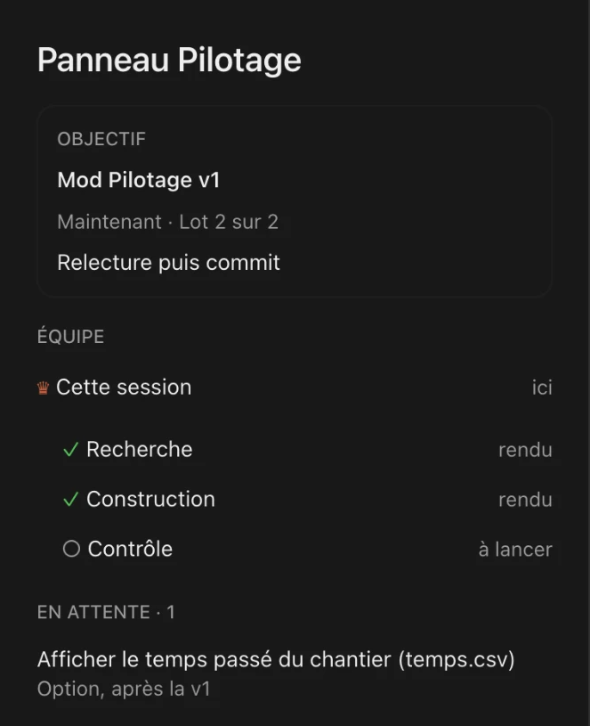
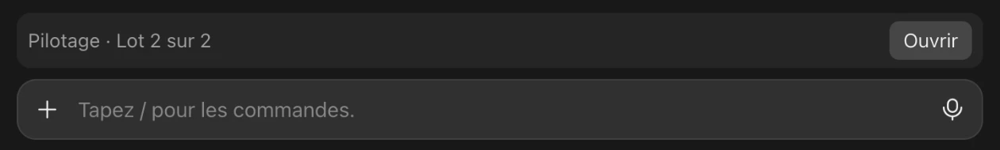

# Pilotage — a project dashboard for Claude Code

A Claude Code mod that docks a pane beside the chat showing **where the project stands**: what Claude is waiting for from you, who is working, what is done and what comes next.

> The interface and the keywords of the `PILOTAGE.md` file are in **French**. This README explains every word you will see.

<p align="center">
  
</p>

---

## Why

On a real project you quickly end up with several things in parallel: a session writing code, agents searching or reviewing, feedback you send as it comes. And you lose track:

- *What is Claude waiting for from me, right now?*
- *Who is working, and on what?*
- *What is done, and what comes next?*

The pane answers those three questions at a glance, without typing anything.

## What it shows

The overview fits on one screen; details open on click.

| Block (French label) | What you see |
| --- | --- |
| **À toi** (your turn) | one line at the top. **Blue**: items you can handle. **Orange**: Claude stopped and is waiting for you. **Grey** "Claude réfléchit · rien à faire" (Claude is thinking, nothing to do): your items come back when it is done. A click shows the list: "À répondre maintenant" (answer now), then "Quand tu peux" (when you can). |
| **Objectif** (goal) | the deliverable and the stage, the current action, the time spent. |
| **Équipe** (team) | the **chef** (the session itself) and its state; while it works, `↳` says what it is doing. Then **Agents en cours** (running agents), **Tâches du chef** (⚙ commands, servers, watchers started in the background — not agents), **À lancer** (to start), **Fait** (done). |
| **Prochain lot** (next batch) | upcoming work grouped by subject, as many subjects as the screen holds, the rest as "+ N autres". |
| **?** | next to an agent, a task, a subject or an item: fills `/btw Question sur « … » :` in the prompt box, to ask a question without interrupting Claude. |

On click:

- **An agent**: what it is in charge of, its files, its mission in one sentence, its steps (one title and one line each; "Tout le détail" expands them), what it delivered and why, its latest actions.
- **A chef task**: what it is for, how long it has been running, its command.
- **A next-batch subject**: its tasks.

When the pane is closed, a **one-line band** above the prompt box sums things up, with an **Ouvrir** (open) button.

<p align="center">
  
</p>

## How it works

The pane combines two sources.

```
 PILOTAGE.md (written by Claude)         what the mod sees live
 ───────────────────────────────         ─────────────────────────────
 heading, workstreams, done,             agents started and finished,
 your turn, waiting                      their brief, background tasks,
                │                        end-of-turn question, your message
                └──────────────┬─────────────────┘
                               ▼
                        the Pilotage pane
```

- **The flight plan** (`PILOTAGE.md`) states the intent: the heading, the workstreams, what is done, what is expected from you, what comes next. Claude writes and maintains it; you only read it in the pane.
- **The live feed** states reality: a new agent shows up at once with its mission; a question Claude asks at the end of a turn goes straight into "À toi"; as soon as you send a message, "À toi" turns grey while Claude reads it.

The pane only displays. It is accurate if Claude keeps `PILOTAGE.md` up to date (see the method below) and names and briefs its agents following a simple convention.

### How it finds the project

The mod looks for a `PILOTAGE.md` in the session folder or above; otherwise, the one the session read or wrote during the conversation (the link is remembered). It never shows another session's project. Without a file, it says so.

## The `PILOTAGE.md` file

Section names are **fixed French keywords**: the mod reads them. The content can be in any language.

```markdown
# Pilotage : Website for Northwind Carpentry
Updated: 2026-11-14
Cap : Website v1, batch 2 of 3 : project pages

## Sessions
| Session | Deliverable | Folder | État |
| --- | --- | --- | --- |
| Website | pages, design, launch | ~/sites/northwind | en cours |

## Fronts
| Front | Files | Agent | État |
| --- | --- | --- | --- |
| Projects | projects/*.html | Projects · construction : 6 project pages | en cours |
| Review | none | Review · contrôle : review batch 2 | à lancer |

## Fait
- Scope approved by the client (11/10)

## À toi
- ! Photos : ask the client for before/after shots of the kitchen
- Home page : check it on your phone

## En attente
- Quote : online quote form after v1
- Reviews : show them once the client has 10
- Toi : remind the client about the team bios
```

| Keyword | Meaning | Rule |
| --- | --- | --- |
| `# Pilotage :` | project name | first line. |
| `Cap :` | heading | `deliverable, stage : action` (with a space before each colon). The pane splits the line by itself. |
| `## Sessions` | sessions | one row per Claude session working on the project. |
| `## Fronts` | workstreams | one workstream = its own files and a deliverable. Recognised states (`État`): `à lancer` (to start), `en cours` (running), `rendu` (delivered), `contrôlé` (reviewed). |
| `## Fait` | done | one plain line per finished batch, with the date. |
| `## À toi` | your turn | what you can do **now**, nothing else (question, approval, test, screenshot), as `Topic : detail`. A leading `!` marks what blocks the rest: it comes first. Empty when there is nothing: a line wholly in parentheses is ignored. |
| `## En attente` | waiting | each line starts with its owner: a short topic (the pane groups by topic) or `Toi :` (something for you, later; shown as "Toi, plus tard"). |
| `Livré :` | delivered | optional line under `Cap :`, with a date: the project is finished. The pane says so under the title. |

More examples in [`examples/`](examples/): small-business website, email automation, tool comparison, online course. All names in them are invented.

## The method, on Claude's side

The pane is only accurate if Claude follows a few rules. Paste this into your project's `CLAUDE.md`, or into `~/.claude/CLAUDE.md` for all projects:

```markdown
## Pilotage
- When a project starts: stop, then write `PILOTAGE.md` at the root (template: the Pilotage mod README). Show it in five lines and wait for approval. Only this session writes it.
- Route each message in one line: same workstream, other workstream (new agent), other project (another session), question (answer here).
- One agent per workstream, only if the workstreams touch different files. An agent that delivered its batch does not get the next one.
- Name each agent `Front · type : action` (types: recherche, construction, correction, contrôle — research, build, fix, review). Its brief starts with `Mission : <one simple sentence>`, then numbered steps, one short action each. Its report ends with `En une phrase : …` and `Pourquoi : …`.
- "À toi" says what I can do now, nothing else. Whatever you expect from me goes in, in the same turn; whatever is no longer true comes out at once (answered, or being changed: it waits in "En attente" as `Toi : …` and comes back when ready); nothing to do means an empty section.
- After each batch: a neutral review, a line in "Fait". When the project is delivered: a `Livré : <date>` line.
```

What happens at each step:

1. **Start**: Claude writes the flight plan. The pane opens by itself.
2. **Each message**: Claude routes it (same workstream, other workstream, other project, simple question) and updates "À toi" first. While it works, "À toi" is grey.
3. **Agents**: each one appears in "Agents en cours" with its mission and steps, then in "Fait" with what it delivered and why.
4. **End of turn**: if Claude asks you something, it goes into "À toi". If it stops to wait for you, the line turns orange.
5. **End of batch**: neutral review, "Fait" updated, next batch grouped by topic.
6. **Delivery**: a `Livré :` line; the pane says the project is delivered.

If `PILOTAGE.md` has not been written for three days or more, the pane says so under the title: what it shows may be out of date.

## Duration estimates

Models are poor at estimating how long their own work takes. So the mod asks Claude nothing: it **measures**. Every finished agent is recorded (type, duration, number of actions); an agent running past the usual duration for its type is flagged "long". Nothing below 5 measurements: no signal beats a wrong one. The type is read from the agent name (`Front · type : action`).

## Time spent

If a `temps.csv` file with a `duree_min` column (minutes) sits in the project folder or above, the Objectif card shows the total. Without it, nothing.

## Install

From a terminal:

```bash
claude plugin marketplace add Anderson-Gomes-Lab/claude-code-pilotage
```

```bash
claude plugin install pilotage@claude-code-pilotage --scope user
```

`--scope user` enables it in all your projects. In the desktop app: **+** next to the prompt box, **Plugins**, **Add marketplace** with `Anderson-Gomes-Lab/claude-code-pilotage`, then **Add plugin**.

The pane opens by itself as soon as the session has a `PILOTAGE.md`. Otherwise: `/panneau-pilotage`.

**Update**: `claude plugin marketplace update claude-code-pilotage`, then `claude plugin update pilotage@claude-code-pilotage`. Open sessions pick up the new version by themselves; if one does not, run `/reload-plugins` in it.

## What the mod writes on your machine

- `~/.claude/pilotage/durees.json`: durations of finished agents (type, minutes, number of actions; no content).
- `~/.claude/pilotage/sessions/<id>.txt`: the project linked to each session.
- `~/.claude/pilotage/missions/<id>.json` and `finis/<id>.json`: agent briefs and reports, to show them again after a reload.
- `~/.claude/pilotage/ecran.json`: the pane height, to fit the overview on screen.
- `<project>/.pilotage/<id>.json`: each session's running agents, for other sessions on the same project. A `.gitignore` is created there.

Nothing leaves your machine.

## Limits

- French interface and keywords.
- The pane takes the place of the desktop app's Details column; hence the band when it is closed.
- What the pane says about intent ("À toi", next batch) depends on Claude keeping `PILOTAGE.md` up to date. The live feed (agents, tasks, end-of-turn questions) depends only on the mod.
- Claude Code mods are new: a Claude Code update may require a mod update.

## About

Built by [Anderson Gomes](https://github.com/Anderson-Gomes-Lab) to run real projects with Claude Code. Shared as is, with no support commitment. Feedback is welcome in the issues.

MIT licence.
